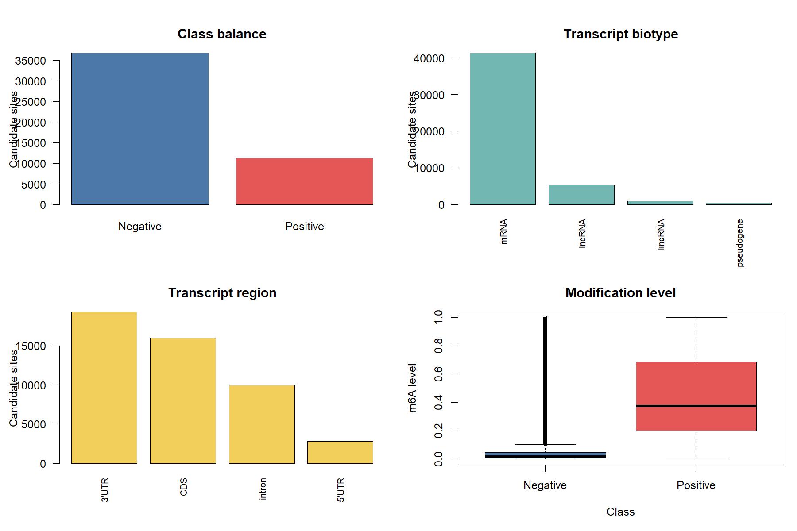
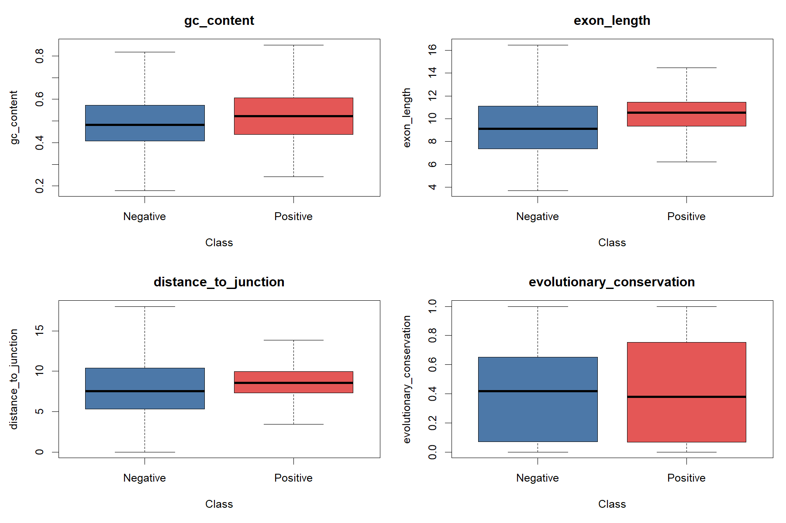
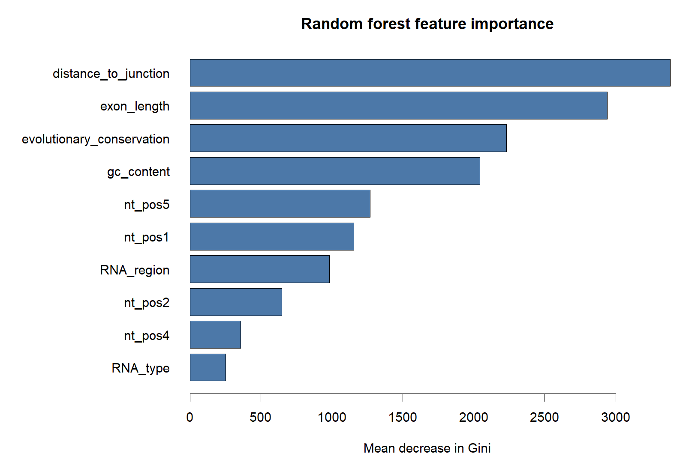
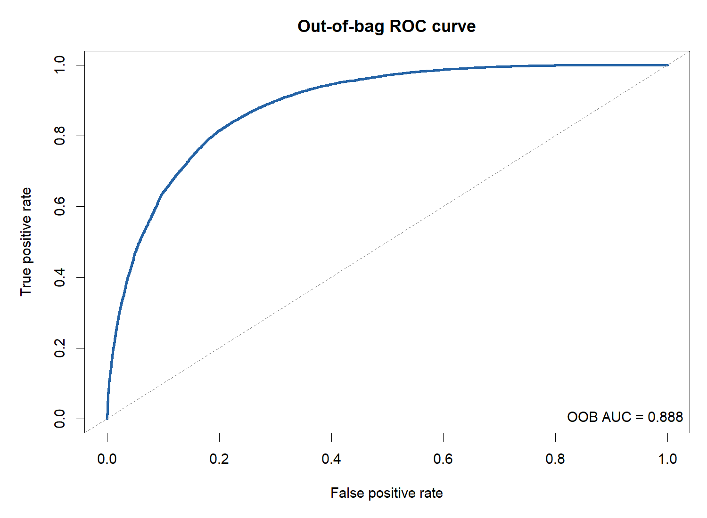
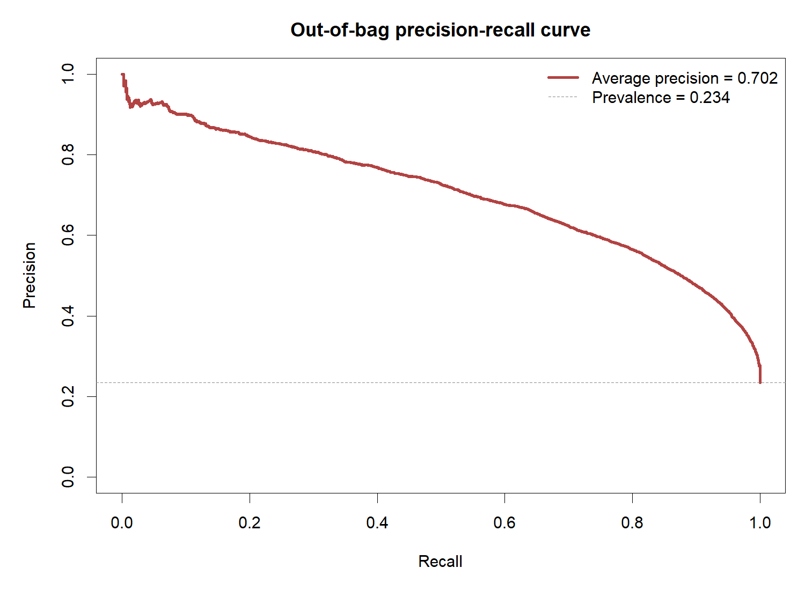
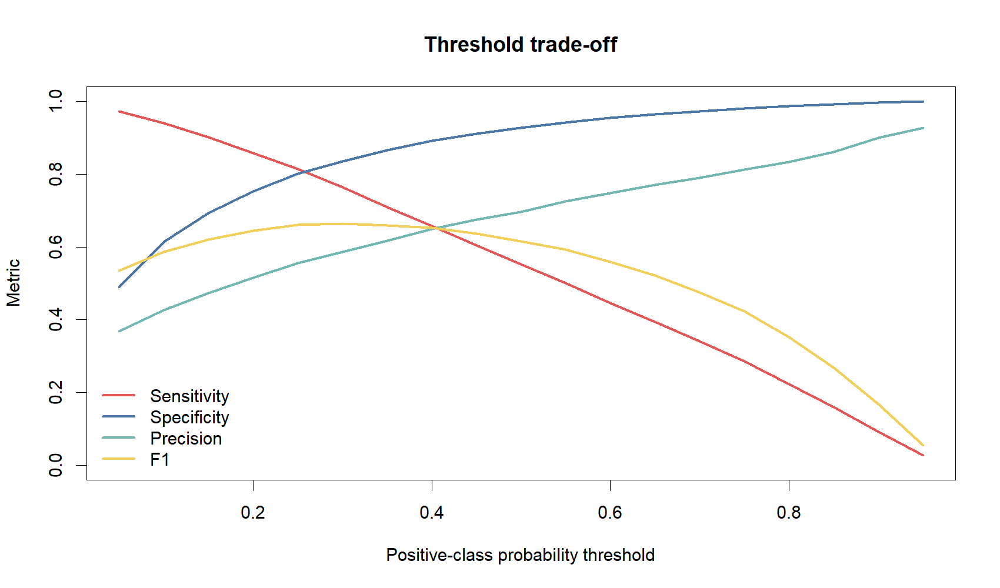
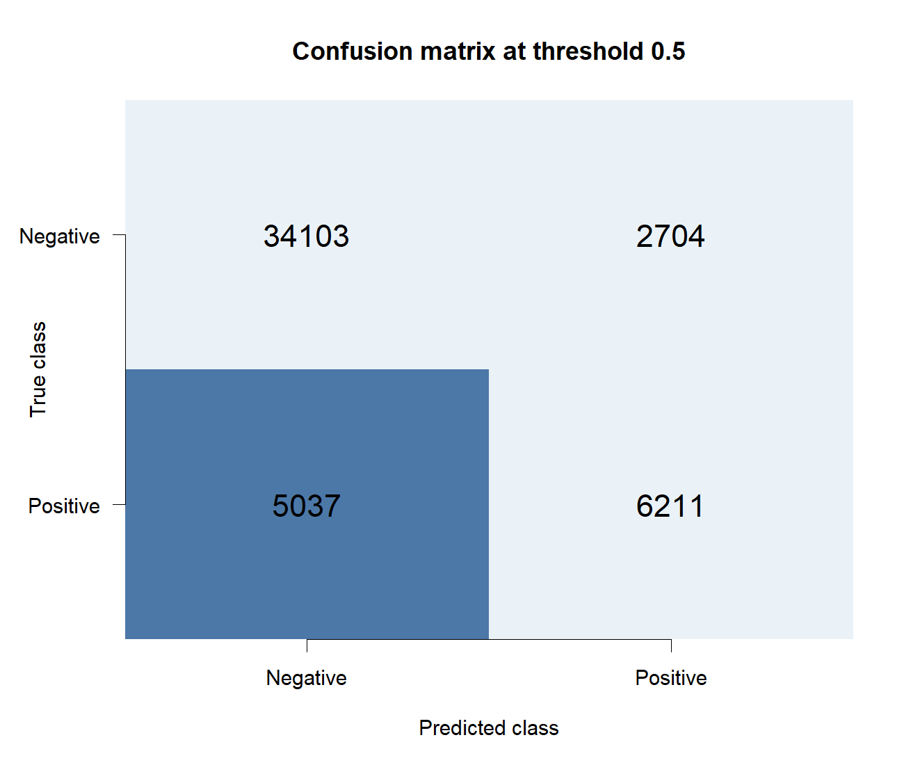
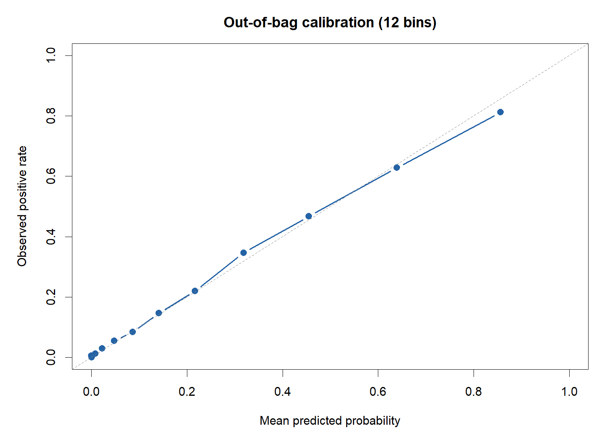

m6APrediction: predicting m6A RNA modification sites with a random forest ================

# Overview

I built **m6APrediction** to estimate whether a candidate adenosine in a human transcript may be an m6A site. `prediction_single()` predicts one site, while `prediction_multiple()` predicts a table of sites and adds a probability and a class label. The package includes a fitted model and a small example table, so it can be used without an internet connection after installation.

## At a glance

| Item | Value |
|------------------------------------|------------------------------------|
| Task | Binary classification of candidate adenosines (m6A vs. not m6A) |
| Algorithm | Random forest (`randomForest` 4.7-x), 500 trees, `mtry = 3` |
| Training sites | 48,055 human candidate sites |
| Class balance | 11,248 positive / 36,807 negative (23.4% prevalence) |
| Predictors | 6 numeric or categorical features + 5 encoded nucleotide positions |
| Out-of-bag AUC | 0.888 |
| Out-of-bag average precision | 0.702 |
| Default decision threshold | 0.5 |

# Installation

The package needs R 3.5.0 or newer and `randomForest`. The other listed packages are only needed to generate this report.

``` r
# From the source tarball
install.packages("m6APrediction_1.0.0.tar.gz", repos = NULL, type = "source")

library(m6APrediction)
```

# Quick start

## One site

``` r
library(m6APrediction)

ml_fit <- readRDS(system.file("extdata", "rf_fit.rds",
                              package = "m6APrediction", mustWork = TRUE))

prediction_single(
  ml_fit = ml_fit,
  gc_content = 0.65,
  RNA_type = "mRNA",
  RNA_region = "CDS",
  exon_length = 10.63,
  distance_to_junction = 7.66,
  evolutionary_conservation = 0.18,
  DNA_5mer = "GGACA"
)
#> predicted_m6A_prob predicted_m6A_status
#>             "0.946"           "Positive"
```

`prediction_single()` returns a probability and a class label. By default, a site is labelled positive when its probability is above 0.5. This cutoff can be changed with `positive_threshold`.

## A table of sites

``` r
library(m6APrediction)

ml_fit <- readRDS(system.file("extdata", "rf_fit.rds",
                              package = "m6APrediction", mustWork = TRUE))

example_csv <- system.file("extdata", "m6A_input_example.csv",
                           package = "m6APrediction")
sites <- read.csv(example_csv)

scored <- prediction_multiple(ml_fit = ml_fit, feature_df = sites,
                              positive_threshold = 0.5)
head(scored[, c("DNA_5mer", "predicted_m6A_prob", "predicted_m6A_status")], 3)
#>   DNA_5mer predicted_m6A_prob predicted_m6A_status
#> 1    GAACA              0.876             Positive
#> 2    GAACC              0.000             Negative
#> 3    AAACT              0.498             Negative
```

The input table needs the seven features listed below. Other columns are kept in the output, which adds `predicted_m6A_prob` and `predicted_m6A_status`.

# Data

The course dataset contains 48,055 candidate sites and 16 columns. Seven columns are model features; the others record site identifiers, coverage and m6A level.

| Variable | Role | Type | Description |
|:-----------------|:-----------------|:-----------------|:-----------------|
| chromosome | Identifier / annotation | character | Reference chromosome |
| start | Identifier / annotation | integer | Genomic start of the site |
| end | Identifier / annotation | integer | Genomic end of the site |
| width | Identifier / annotation | integer | Genomic width of the site |
| strand | Identifier / annotation | character | Genomic strand (+/-) |
| m6A_status | Label | character | Modification label (Positive / Negative) |
| m6A_coverage | Coverage | integer | Reads supporting the modification |
| total_coverage | Coverage | integer | Total reads at the locus |
| m6A_level | Label source | numeric | Quantitative modification level (0-1) |
| gc_content | Predictor | numeric | GC content of the local sequence (0-1) |
| DNA_5mer | Predictor | character | DNA 5-mer centred on the candidate adenosine |
| RNA_type | Predictor | character | Transcript biotype |
| RNA_region | Predictor | character | Transcript region |
| exon_length | Predictor | numeric | Host exon length (log-transformed units) |
| distance_to_junction | Predictor | numeric | Distance to the nearest splice junction (log-transformed units) |
| evolutionary_conservation | Predictor | numeric | Cross-species evolutionary conservation (0-1) |

Variables in the m6A training table.

The model uses only the seven predictor columns. `m6A_status` is the label; coverage, m6A level and genomic coordinates are not used as model inputs.

## Class balance and composition

::: {.figure style="text-align: center"}


<p class="caption">

Dataset overview. (A) Class balance. (B) Transcript biotype. (C) Transcript region. (D) Distribution of the quantitative m6A level.

</p>
:::

The classes are uneven: 23.4% of the sites are positive. Most rows are mRNA (86.1%). The dataset also has many sites in 3’UTRs (40.2%) and CDS regions (33.2%). The positive rate is 26.1% in 3’UTRs and 16.8% in introns, so I included transcript region and type as model features.

| Annotation | Level      |  Sites | Positive |
|:-----------|:-----------|-------:|---------:|
| RNA_type   | lincRNA    |    869 |    20.5% |
| RNA_type   | lncRNA     |  5,439 |    17.7% |
| RNA_type   | mRNA       | 41,365 |    24.3% |
| RNA_type   | pseudogene |    382 |    16.5% |
| RNA_region | 3’UTR      | 19,307 |    26.1% |
| RNA_region | 5’UTR      |  2,809 |    25.1% |
| RNA_region | CDS        | 15,968 |    24.0% |
| RNA_region | intron     |  9,971 |    16.8% |

Sites per annotation level and the positive rate within each level.

# Methods

## Feature encoding

The seven input features are:

1.  `gc_content` — GC content of the local sequence;
2.  `RNA_type` — mRNA, lincRNA, lncRNA or pseudogene;
3.  `RNA_region` — CDS, intron, 3’UTR or 5’UTR;
4.  `exon_length` — host exon length on the log scale used during training;
5.  `distance_to_junction` — distance to the nearest splice junction, log scale;
6.  `evolutionary_conservation` — conservation score between 0 and 1;
7.  `DNA_5mer` — the five nucleotides centred on the candidate adenosine.

`dna_encoding()` splits each 5-mer into five letter columns. The prediction functions do this automatically, so the input stays as one five-letter string. In this dataset the centre letter is always A; the model uses the four surrounding positions instead.

## Model and evaluation

The model has 500 trees and `mtry = 3`. I used its out-of-bag (OOB) predictions to calculate the results below. Each OOB prediction comes from trees that did not use that site for training. The report shows AUC, average precision and results at different probability cutoffs.

# Results

## Feature distributions by class

::: {.figure style="text-align: center"}


<p class="caption">

Distributions of the four continuous predictors, split by observed class.

</p>
:::

| Status | gc_content | exon_length | distance_to_junction | evolutionary_conservation |
|:--------------|--------------:|--------------:|--------------:|--------------:|
| Negative | 0.48 | 9.11 | 7.52 | 0.42 |
| Positive | 0.52 | 10.52 | 8.55 | 0.38 |

Median predictor values in the two classes.

Compared with negative sites, positive sites have higher median GC content, exon length and junction distance. Their median conservation score is lower.

## Variable importance

::: {.figure style="text-align: center"}


<p class="caption">

Random forest variable importance (mean decrease in Gini impurity).

</p>
:::

`distance_to_junction` and `exon_length` have the highest importance scores. Conservation and GC content follow. The positions beside the central A also contribute, while `RNA_type` has the lowest score in this model.

## Discrimination: ROC and precision-recall

::: {.figure style="text-align: center"}


<p class="caption">

Out-of-bag ROC curve.

</p>
:::

::: {.figure style="text-align: center"}


<p class="caption">

Out-of-bag precision-recall curve. The dashed line is the positive-class prevalence (0.234).

</p>
:::

The OOB AUC is 0.888 and average precision is 0.702. The positive class makes up 0.234 of the data, so the precision-recall curve is useful for seeing how well the model finds positive sites.

## Choosing an operating threshold

::: {.figure style="text-align: center"}


<p class="caption">

Sensitivity, specificity, precision and F1 as a function of the positive-class probability threshold.

</p>
:::

| Threshold | Sensitivity | Specificity | Precision | Accuracy |    F1 | Predicted positive |
|----------:|----------:|----------:|----------:|----------:|----------:|----------:|
|      0.30 |       0.763 |       0.836 |     0.587 |    0.819 | 0.664 |             14,628 |
|      0.40 |       0.657 |       0.892 |     0.649 |    0.837 | 0.653 |             11,380 |
|      0.50 |       0.552 |       0.927 |     0.697 |    0.839 | 0.616 |              8,915 |
|      0.60 |       0.446 |       0.954 |     0.748 |    0.835 | 0.559 |              6,717 |
|      0.70 |       0.340 |       0.972 |     0.790 |    0.824 | 0.476 |              4,842 |

Operating characteristics at selected thresholds.

At the default cutoff of 0.5, the model labels 8,915 sites as positive, of which 6,211 are true positives (precision 69.7%). It misses 5,037 true sites (sensitivity 55.2%). At 0.30, sensitivity rises to 76.3% and F1 is 0.664, with more false positives. The cutoff can be changed with `positive_threshold` depending on the intended use.

::: {.figure style="text-align: center"}


<p class="caption">

Confusion matrix at the default threshold of 0.5.

</p>
:::

## Calibration

::: {.figure style="text-align: center"}


<p class="caption">

Calibration plot: observed positive rate against mean predicted probability in 12 probability bins.

</p>
:::

The plotted probabilities are mostly close to the diagonal. In the highest group, the mean prediction is about 0.86 and the observed positive rate is about 0.81, so the model slightly overestimates positives there.

## Performance summary

| Metric              | Value |
|:--------------------|------:|
| AUC                 | 0.888 |
| Average precision   | 0.702 |
| Baseline prevalence | 0.234 |
| Accuracy            | 83.9% |
| Sensitivity         | 55.2% |
| Specificity         | 92.7% |
| Precision           | 69.7% |
| F1                  | 0.616 |

Out-of-bag performance at the default 0.5 threshold (AUC and AP are threshold-free).

# Discussion

In this dataset, the model relies most on distance to a splice junction and exon length. It also uses sequence and conservation features.

Limitations to keep in mind:

- At the default cutoff, sensitivity is 55.2%. A lower cutoff finds more positive sites but also gives more false positives.
- The model was trained on this human dataset and its feature definitions. Its results may differ on another dataset or when the input values use different scales.
- These results use OOB predictions from the training data. I have not checked the model on a separate dataset.

# Reproducibility

| Script | Purpose |
|------------------------------------|------------------------------------|
| `data-raw/prepare_oob.R` | Exports OOB probabilities from the fitted model |
| `data-raw/make_figures.R` | Rebuilds every figure and every number in this report |

Software used to build this report.

| Component    | Version |
|:-------------|:--------|
| R            | 4.6.2   |
| randomForest | 4.7.1.2 |
| ggplot2      | 4.0.3   |
| knitr        | 1.52    |
| rmarkdown    | 2.32    |

# License

MIT © the package authors. See `LICENSE`.
